# ESP32-P4 3D Engine

**e3d** is a software 3D engine for the **ESP32-P4**, originaly developed by **Michael Blostien**. It draws lit, shadowed,
depth-tested triangles into an RGB565 frame on both CPU cores, with the P4's PIE
vector unit and no GPU. On a 400x240 frame it runs scenes of a few thousand triangles
with shadows at about **60 fps**.

<p align="center">
  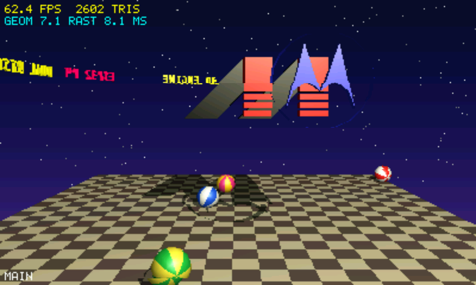
  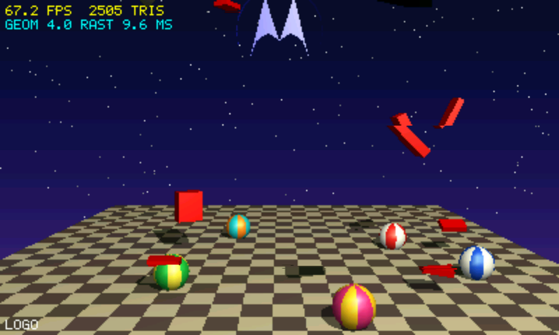
</p>
<p align="center">
  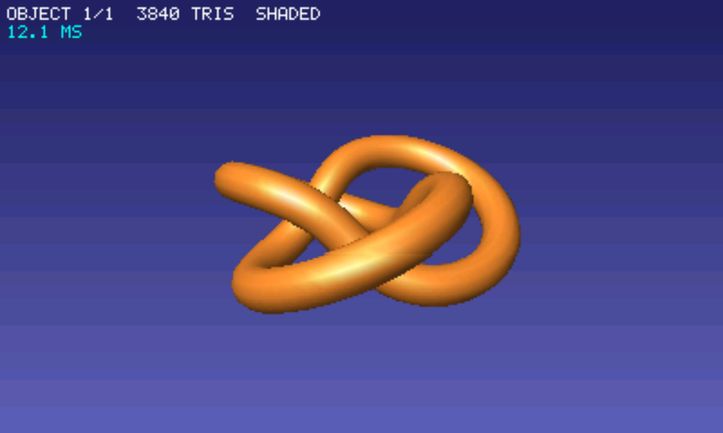
  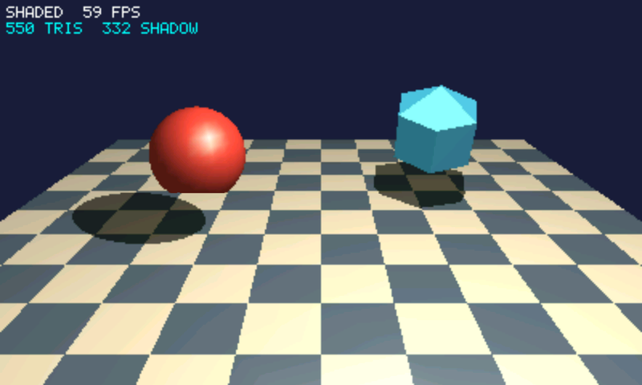
  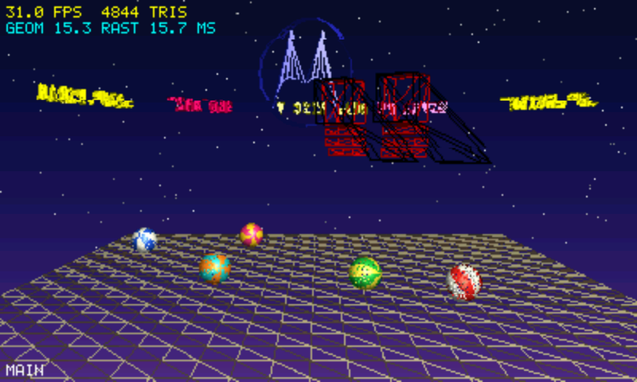
</p>

You can use it two ways:

- As an **ESP-IDF component**, in your own firmware.
- As part of a **PAPP**, an app for the
  [ESP32_P4_Launcher](https://github.com/giltal/ESP32_P4_Launcher).

The repository also has:

- A **Python converter** that turns STL and OBJ models into engine meshes.
- **Five examples**, including a full demo show.
- **Two games** you can install on the launcher: [Shardwall](#a-game-shardwall), a 3D
  brick-breaker, and [Voidmarch](#a-second-game-voidmarch), a 3D invaders game.
- A **[user guide](docs/GUIDE.md)**.

All the screenshots on this page come straight from a Guition JC1060P470C board (7"
1024x600 panel). The engine draws 400x240, and the PPA scales it up 2.5x. The frame
rate in the corner of a shot is lower than normal while the screenshot is taken.

---

## Features

- **Lit triangles:**
  - Gouraud and flat shading.
  - One point light with ambient, diffuse and Blinn-Phong specular light.
  - Normals smooth across edges below a crease angle and sharp across steeper ones.
- **Floor and shadows:**
  - A floor layer is drawn as the background.
  - Every other object casts a planar shadow on it, darkened only once per pixel.
- **Effects:**
  - Depth fog.
  - A glow at the light.
  - Wireframe, double-sided and unlit objects.
  - A background image, or a background drawn by a function.
  - 5x7 overlay text.
- **Correct geometry:** near-plane clipping, a perspective-correct depth buffer and
  sub-pixel rasterising.
- **Meshes:**
  - Built in code, made by the sphere and floor helpers, or loaded from a simple text
    format.
  - Converted from **STL / OBJ** by `tools/stl2e3d.py`.
  - Shared by any number of objects, each with its own matrix, flags and colour.
- **Fast on the P4:**
  - Geometry and rasterising both run on **both cores**.
  - The frame is drawn in 16-row bands in internal SRAM.
  - Lighting is batched in **PIE** 16-bit fixed point.
  - Most of the pipeline is integer.
- **Portable core:** one platform header (`e3d_port.h`) has backends for ESP-IDF, the
  PAPP SDK and a desktop test build.

| Limits | |
|---|---|
| Per mesh | 65535 vertices, 21845 triangles |
| Lights | one point light |
| Pixels | RGB565 |
| Not supported | textures, transparency, shadows on anything but the floor |

---

## The examples

| | Example | Kind | What it shows |
|---|---|---|---|
| 1 | [`examples/papp/demo`](#1-the-demo-show) | PAPP | the full show of the original engine: 64 objects, every feature |
| 2 | [`examples/papp/hello_cube`](#2-hello_cube) | PAPP | the smallest program: a mesh built in code |
| 3 | [`examples/papp/shadows`](#3-shadows) | PAPP | floor, shadows, a moving light, the four styles |
| 4 | [`examples/papp/mesh_viewer`](#4-mesh_viewer) | PAPP | STL models: converted at build time or loaded from the SD card |
| 5 | [`examples/idf/guition_p4_7`](#5-bare-esp-idf-firmware-guition_p4_7) | ESP-IDF | the engine without the launcher: panel driver, PPA scaling, double buffering |

### 1. The demo show

`examples/papp/demo` is the original PowerPC engine's demo, rebuilt on e3d. The camera
flies through a scripted show:

| Part | What happens |
|---|---|
| **ARE / YOU / READY** | Spinning 3D letters fly past the camera over a starry sky. |
| **Countdown** | The numbers 9 to 0 tumble towards the camera. |
| **Approach** | The camera rolls down towards the floor, which swings into view. The light's glow appears. |
| **Balls** | Five striped beach balls drop and bounce, with their shadows. |
| **Logos** | One logo rises and flies in, and the striped logo assembles from its parts. |
| **Main** | Everything turns. The balls roll and collide, and a ring of 3D text circles the scene. Then the camera flies away and the show loops. |

<p align="center">
  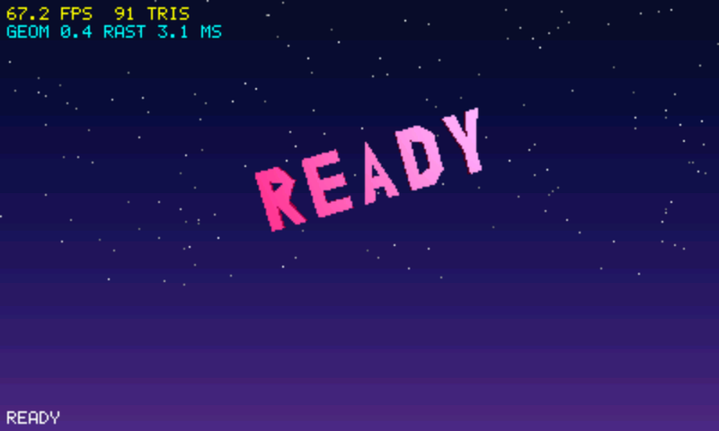
  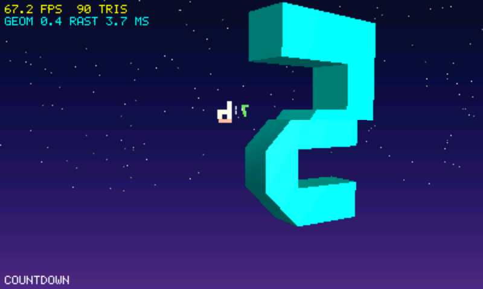
  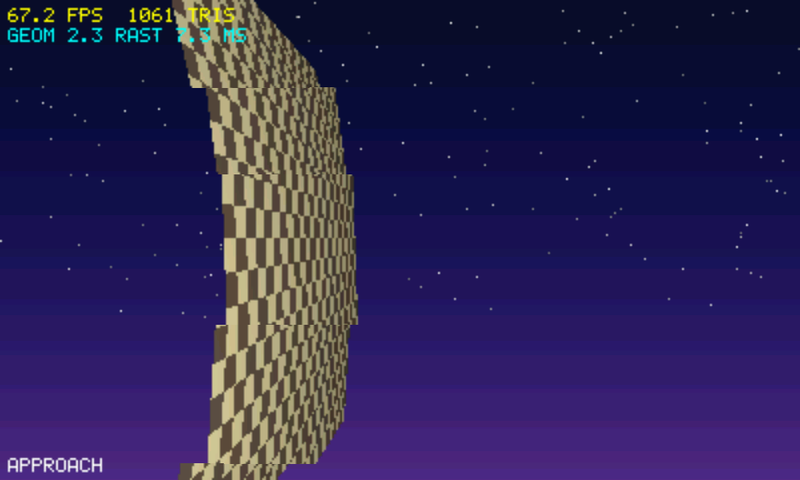
</p>
<p align="center">
  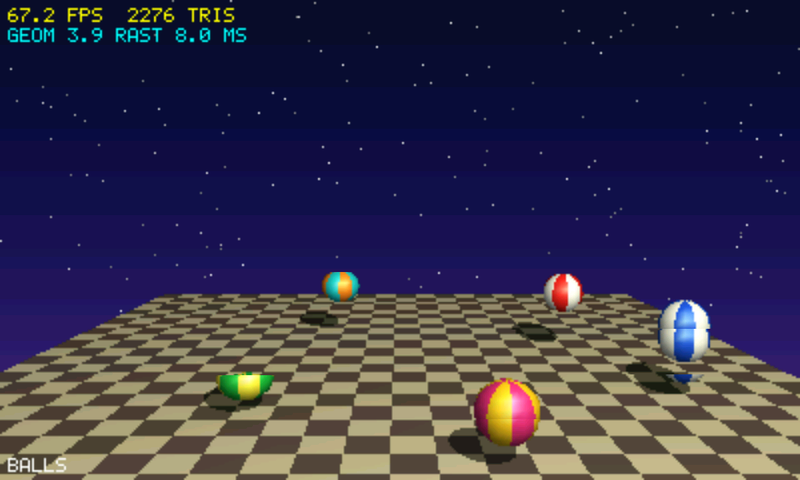
  
  
</p>

The four styles of the main scene, from left: flat, wireframe and fog. Shaded is shown
above.

<p align="center">
  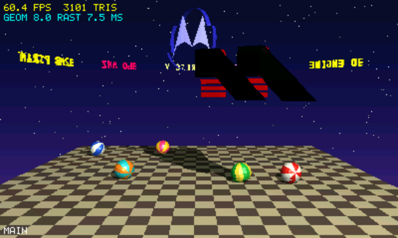
  
  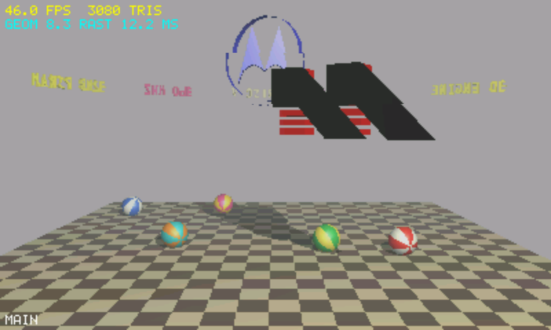
</p>

Inside, the demo:

- Uses the original object files (`ReferenceCode/*.txt`), embedded into the app at build
  time.
- Draws the sky gradient and stars with a background row function.
- Has 64 objects in the main scene: the letters, numbers, 5 logo parts, 5 balls,
  the floor and the ring of text. That is 1.8-3.4k triangles plus about 800 shadow
  triangles.
- Times every motion from the elapsed time, so the show runs at the same pace at any
  frame rate.
- Presents through a presenter thread with two frame buffers, so the PPA scaling of one
  frame overlaps drawing the next.

| Button | Action |
|---|---|
| A | skip to the next part of the show |
| START | restart the show |
| Y | style: shaded, flat, wireframe, fog |
| X | HUD on or off (fps, triangles, geometry and raster ms) |
| D-pad, L1 / R1 | in the main scene: move and turn the camera |
| B | exit |

To start straight at the main scene in a given style (0-3), pass arguments:
`deploy ... -- main 2`.

| Main scene | fps (whole-run average) |
|---|---|
| shaded | 62.6 |
| flat | 64.2 |
| fog | 49.6 |
| wireframe | 37.9 |

### 2. hello_cube

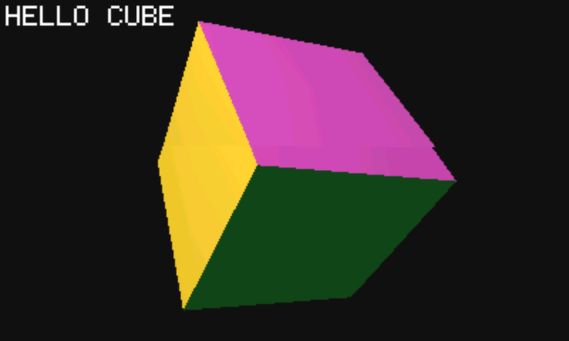

This is about 100 lines. It covers:

- A cube built with `e3d_mesh_create` and `e3d_mesh_finish`, with one colour per face.
- A model matrix made each frame from a rotation and a move (`e3d_rotate`, `e3d_move`,
  `e3d_mul`).
- The frame itself: `e3d_begin`, `e3d_draw`, `e3d_end`.
- Overlay text.
- The simplest way to present in a PAPP: a surface with two buffers, locked and
  presented.

It runs at 67 fps, the pace of the display. B exits.

<br clear="right">

### 3. shadows


A ball bounces and a faceted gem spins and hovers over a tiled floor, while the light
circles above them. It covers:

- `E3D_FLOOR`, and drawing the floor first so that objects drawn after it cast
  shadows.
- The shadow settings: `shadows`, `shadow_y` and `shadow_dark`.
- Moving the light, and its glow (`e3d_draw_light`).
- A low-poly sphere as a faceted gem (`E3D_FLAT`).
- Statistics from `e3d_get_stats`.

Y steps through the styles (shaded, flat, wireframe, fog), X turns the shadows on and
off, and B exits. It draws about 550 triangles plus 330 shadow triangles at 59 fps.

<br clear="right">

### 4. mesh_viewer

<p align="center">
  
  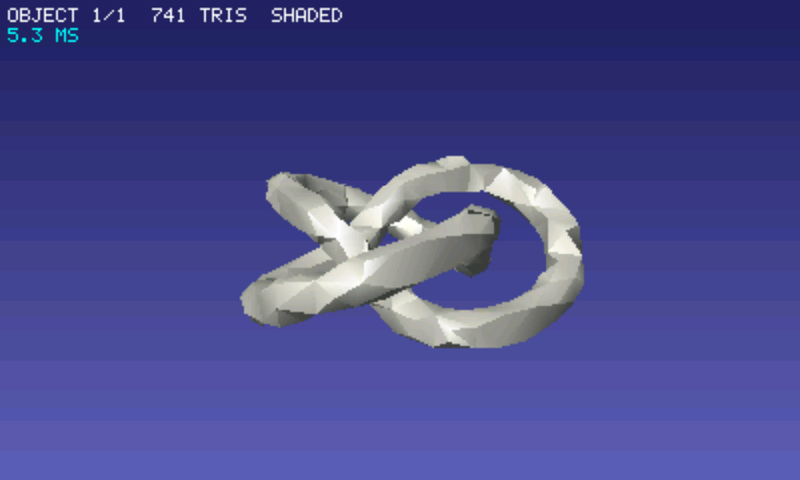
</p>

An orbit camera around a model. The two shots above are:

- **Left:** the built-in model, `examples/assets/knot.stl` (3840 triangles). The app's
  `build.py` runs `tools/stl2e3d.py` on it during the build and includes the generated
  header.
- **Right:** the same knot decimated to 741 triangles with `--max-tris 800`, copied to
  the SD card as a text file, and opened with
  `e3d_mesh_viewer /sd/models/knot_small.txt`. Any text file from the converter works,
  and A steps through the objects in it.

It also covers:

- Framing the model from its bounding sphere.
- A light that follows the camera.
- A gradient background drawn by `e3d_set_background_rows`.

| Button | Action |
|---|---|
| D-pad | orbit |
| L1 / R1 | zoom |
| A | next object |
| Y | style |
| X | auto-spin |
| B | exit |

The knot takes about 12 ms of engine time per frame.

### 5. Bare ESP-IDF firmware: guition_p4_7

`examples/idf/guition_p4_7` is a complete ESP-IDF 5.5 project for the Guition
JC1060P470C, with no launcher. It contains:

- `main/display.c`, which:
  - Brings up the JD9165 1024x600 MIPI-DSI panel: DSI PHY power, 2-lane bus, double
    DPI buffers.
  - Scales each 400x240 frame 2.5x with the PPA into the hidden panel buffer.
  - Flips at the next refresh.
  - Does the scaling on a task, so drawing the next frame overlaps it.
- `main/main.c`, the scene: a floor, five balls circling and bouncing around a spinning
  gem, and a moving light with shadows.
- `sdkconfig.defaults` for the board: PSRAM, 360 MHz, flash and chip revision.

The scene draws 1.3k triangles plus about 800 shadow triangles. That takes about 4 ms of
geometry and 7.5 ms of rasterising, at the panel's 67 fps.

```bash
cd examples/idf/guition_p4_7
idf.py set-target esp32p4
idf.py -p COM10 flash monitor
```

> Flashing this replaces whatever firmware the board runs, such as the launcher. To
> go back, reflash that firmware.

To use another board, keep the PPA and present task in `display.c`, and replace the
panel bring-up with your board's.

---

## A game: Shardwall

<p align="center">
  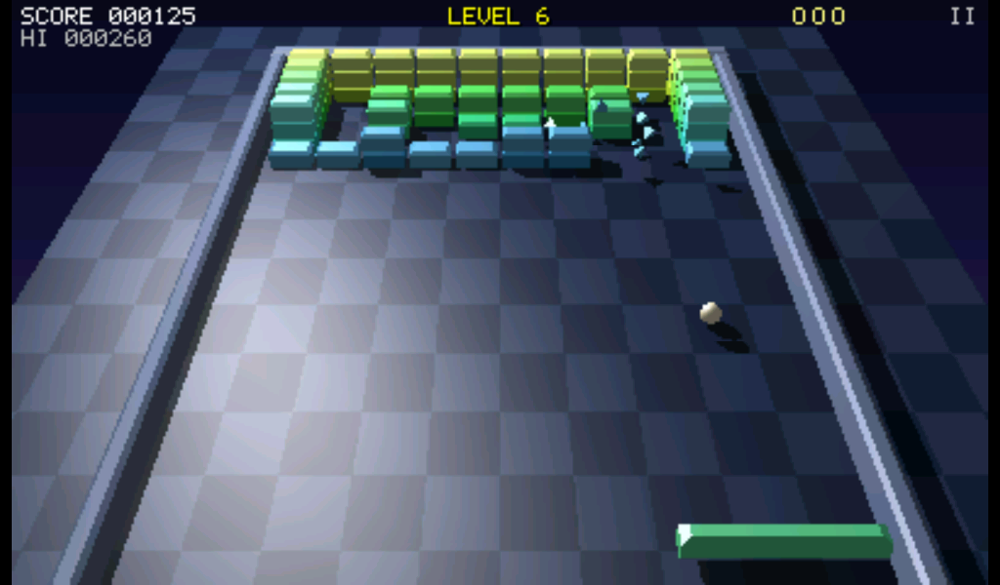
  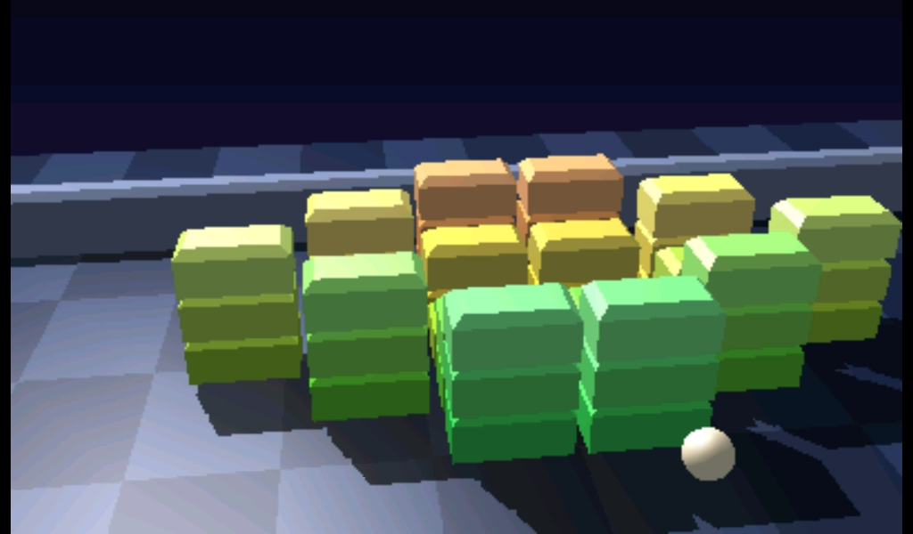
</p>

`game/shardwall` is a complete game on e3d: a brick-breaker in 3D, and the first community
app of the [ESP32_P4_Launcher](https://github.com/giltal/ESP32_P4_Launcher). Install it from
**Settings → Apps → Community**.

- The wall is built of towers 1 to 3 bricks high. Break the bottom brick and the ones above
  drop down.
- Broken bricks burst into shards that bounce on the floor. Everything casts a shadow.
- Power-ups: a wide paddle, three balls, a slower ball. Six levels that loop, faster each time.
- The sound is synthesised in the game and played through the launcher's audio.
- The paddle follows the board's paddle knob, your finger or the D-pad / left stick, whichever
  moved last. A or a tap serves; START or the top-right corner pauses.
- The pause menu saves the game (level, score, lives and what is left of the wall, in
  `/sd/data/shardwall/save.txt`); the title screen then offers Continue.

It runs at the display's 67 fps on the Guition 7" board, and at 55 fps on the busiest level
(90 bricks: 1.7k triangles plus 1.1k shadow triangles). Build it like the examples:

```bash
python game/shardwall/build.py          # -> build/shardwall/shardwall.papp
```

Pass `auto` to let the computer play, or `level N` to start at a level.

---

## A second game: Voidmarch

<p align="center">
  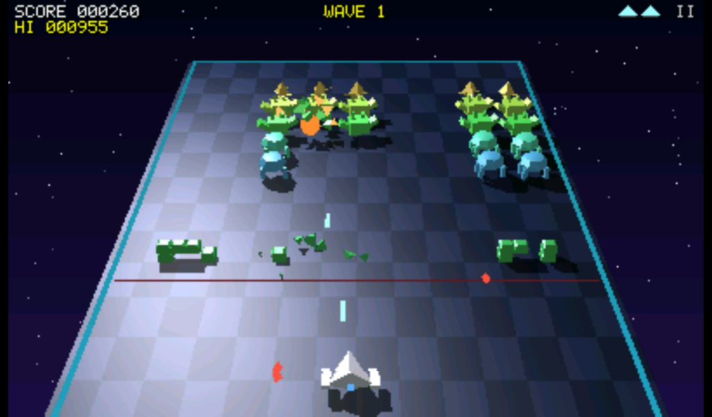
  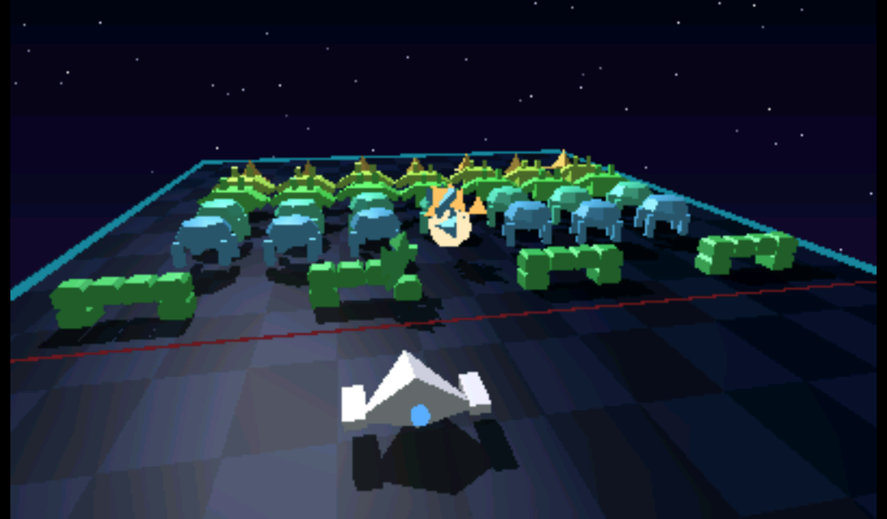
</p>

`game/voidmarch` is a fixed shooter in 3D: a formation of invaders marches across a lit plane,
side to side and a step nearer at each edge, faster as it thins out. The ship moves freely in
its zone at the near end of the plane: left and right, and forwards and back.

- Three kinds of invader that change pose on each step of the march, four bunkers that crumble
  block by block, and a saucer that crosses at the back now and then.
- A formation that reaches the red line in front of your zone costs a life and is pushed back.
  Clear it to finish the wave; the next one starts closer and marches faster. Extra ship at
  1500 points, then every 3000.
- Everything casts a shadow from the lamp. Hits blow up in fireballs and shards that bounce on
  the floor. The sound is synthesised in the game.
- Pad: D-pad or left stick moves (up = forwards), A or B fires. Touch: the ship follows your
  finger, a little ahead of it, and holding fires. START, SELECT or the top-right corner
  pauses (Resume, Restart, Exit).

It runs at 50 to 60 fps on the Guition 7" board (1.9k triangles plus 1.3k shadow triangles with
all 35 invaders), and at 60 fps on the 4.3".

```bash
python game/voidmarch/build.py          # -> build/voidmarch/voidmarch.papp
```

Pass `auto` to let the computer play, or `wave N` to start at a wave.

---

## Quick start

```c
#include "e3d.h"

e3d_t *e = e3d_create(400, 240, 2);                 /* 400x240, both cores */
e3d_mesh *ball = e3d_mesh_sphere(60, 24, 16, 230, 80, 60);

e3d_object obj;
e3d_object_init(&obj, ball);
e3d_move(&obj.m, 300, 0, 0);                        /* the camera looks along +x */
*e3d_light_get(e) = (e3d_light){ .pos = { 0, 400, -300 }, .r = 255, .g = 255, .b = 255 };

for (;;) {
    e3d_begin(e, pixels, 400);                      /* RGB565 target, stride in pixels */
    e3d_draw(e, &obj);
    e3d_end(e);                                     /* geometry + rasterising, both cores */
    show(pixels);
}
```

### In an ESP-IDF project

Point your top-level `CMakeLists.txt` at the component:

```cmake
set(EXTRA_COMPONENT_DIRS "path/to/ESP32_P4_3D_Engine/e3d")
```

Or pull it from git in `main/idf_component.yml`:

```yaml
dependencies:
  e3d:
    git: https://github.com/giltal/ESP32_P4_3D_Engine.git
    path: e3d
```

Then add `e3d` to your component's `REQUIRES`. See
[guide section 2.1](docs/GUIDE.md#21-as-an-esp-idf-component) for the sdkconfig
settings that matter.

### As a PAPP

The build uses the PAPP SDK from a launcher checkout. It looks in `../ESP32_P4_Launcher`,
or in the folder in `PAPP_LAUNCHER`. It also needs a Python with pyelftools, such as the
ESP-IDF one:

```bash
~/.espressif/python_env/idf5.5_py3.12_env/Scripts/python.exe examples/papp/demo/build.py
```

That writes `build/e3d_demo/e3d_demo.papp`. Deploy it from the launcher checkout:

```bash
python tools/papp_dev.py --port COM10 deploy ../ESP32_P4_3D_Engine/build/e3d_demo/e3d_demo.papp
```

In Git Bash, set `MSYS_NO_PATHCONV=1` before passing `/sd/...` paths. The other examples
build the same way, from their own `build.py`.

### Models from STL / OBJ

`tools/stl2e3d.py` needs only Python 3:

```bash
# the text format, for e3d_load_file
python tools/stl2e3d.py model.stl -o model.txt --size 200

# a C header with model_create()
python tools/stl2e3d.py model.stl --header model.h --color FF8020

# several models in one file, decimated to at most 3000 triangles each
python tools/stl2e3d.py a.stl b.obj -o scene.txt --max-tris 3000
```

The converter reads binary STL, ASCII STL and OBJ. For each model it:

- Maps the file's axes to the engine's: z-up for STL, y-up for OBJ, or your own mapping.
- Welds the separate corners STL stores into shared vertices.
- Scales and centres the model.
- Decimates it to a triangle limit by vertex clustering.
- Orders the corners into the engine's winding.

It then reports the bounds and whether the mesh is closed.
[Guide section 13](docs/GUIDE.md#13-models-from-stl-and-obj-files) has the details.

---

## Repository layout

```
e3d/                          the engine, an ESP-IDF component
  include/e3d.h               the API, commented
  src/e3d.c                   meshes, loader, matrices, objects
  src/e3d_render.c            the renderer: geometry, binning, rasterising, PIE kernels
  src/e3d_port.h              platform layer: ESP-IDF / PAPP / host
  src/e3d_mem.h               the engine's heap (PSRAM)
game/
  shardwall                   Shardwall, a 3D brick-breaker (a launcher community app)
  voidmarch                   Voidmarch, a 3D invaders game
examples/
  papp/papp_common.py         shared PAPP build helper
  papp/demo                   the demo show
  papp/hello_cube             the smallest program
  papp/shadows                floor, shadows, light, styles
  papp/mesh_viewer            STL models, orbit camera
  idf/guition_p4_7            bare ESP-IDF firmware for the Guition 7"
  assets/                     sample models (knot.stl) and the script that makes them
tools/
  stl2e3d.py                  STL / OBJ -> e3d text format and C headers
  make_icon.py                draws the demo's launcher icon
docs/
  GUIDE.md                    the user guide
  images/                     the screenshots on this page
ReferenceCode/                the original engine, demo and object files
```

## Object format

These are the original engine's text files, and one file can hold several objects:

```
<objects>
<triangles>                 per object
<v0> <v1> <v2> <R> <G> <B>  one line per triangle, colour 0..255
<vertices>
<x> <y> <z>                 one line per vertex
```

The axes follow the original engine:

- x is depth (the camera looks along +x), y is up, and z is right.
- Outward normals are `(v0 - v1) x (v2 - v1)`.

The loader repairs inconsistent windings and smooths corner normals across edges below
a crease angle.

## Engine design

- **Meshes and objects.** Meshes are shared and never change. Each object is a mesh plus a model matrix. `e3d_transform` adds a transform to an object, as the original `transformObject` did.
- **Camera.** The camera uses the original's heading, pitch and tilt, and its lens (`width / 42.44 * 35`).
- **Lighting.** One point light with ambient, diffuse and Blinn-Phong specular, using Gouraud or flat shading. Lighting is worked out in view space, where the camera is at the origin. Gouraud lighting runs in fixed point with PIE (see below).
- **Floor and shadows.** The floor is drawn as a background layer. Planar shadows land on it at `shadow_y`, and a stencil darkens each pixel only once. The light's projection onto the floor is projective, so together with the view and the object's matrix it is a single 4x4 matrix: a shadow vertex costs 4 rows and one divide. A triangle faces the light exactly when its shadow winds like a front face seen from above, so the silhouette test is the sign of the shadow's screen area.
- **Effects.** Fog, a glow at the light, wireframe, and an optional background image.
- **Clipping and depth.** Triangles are clipped at the near plane, and depth is a perspective-correct 1/x z-buffer.

### How a frame runs

1. `e3d_draw` copies the object into a list.
2. In `e3d_end`, both cores take objects from that list. Each core transforms, lights, culls, clips and projects them into its own draw lists. Each primitive is sorted into the 16-row bands it touches as soon as it is made.
3. Both cores then take bands as they come free (sky bands are cheap, floor bands are not). Each band is drawn in a colour + depth + stencil tile in internal SRAM, then copied to the frame. PSRAM is written once per pixel.
4. Lighting is computed once per unique corner normal per object.
5. Back faces are culled unless an object is `E3D_DOUBLE_SIDED`.

Most of the cost on the P4 is PSRAM traffic, not arithmetic: a cache miss costs about 1 µs while the display hardware is also using PSRAM. The design keeps per-pixel work in internal SRAM for that reason.

- **Fixed point from the projection on.** Each vertex is transformed and projected once, into a screen record: 1/x in 2.30, x and y in 12.4, and a clip code (off which screen edge, behind the near plane, outside the guard band).
  - Most triangles have all three corners on screen records. They are culled with integer tests: the AND of the clip codes for off-screen, and the sign of a 64-bit screen area for back faces. They are then written straight from the records, with no float work.
  - Only triangles that cross the near plane or reach past the guard band (1800 px from the centre, so x stays inside 12.4) take the float path, which clips them.
  - A triangle is binned only into the rows whose pixel centres it covers, and one that covers none is dropped before it is written.
  - Wireframe edges use the same records, and a closed mesh draws each shared edge once.
  - The rasteriser steps edges, depth and colours in integers. Per-triangle setup and each row's start values stay in float: keeping row state in the FPU's own registers measured faster than integer planes, which ran short of integer registers. Shadow triangles skip the colour and depth gradients.
- **Primitives in SRAM.** Each core keeps its primitives (36 bytes each, written as 9 words) in 4.6 KB chunks. The first chunks are in internal SRAM, taken one per frame while the internal heap keeps 40 KB free, up to 8 per core. Further chunks come from PSRAM. Writing a primitive to PSRAM costs about 780 cycles, because each new cache line is read before it is written. In SRAM the cost is much lower, and the rasteriser reads them back from SRAM too. The band bins (16-bit indices) are in SRAM as well. The per-object scratch stays in PSRAM, where measurements showed it costs nothing extra.
- **Engine heap.** `e3d_mem.h` sends the engine's own `malloc`s to PSRAM, 16-byte aligned for PIE. On the launcher, blocks under 1 KB would otherwise go to internal SRAM. The heap can also return the P4's LP SRAM, which is uncached and slow, so SRAM allocations check the address and give such blocks back.
- **Background.** `e3d_set_background_rows` fills each band's rows straight into the SRAM tile. That is much faster than `e3d_set_background`, which copies an image from PSRAM. The demo draws its sky gradient and stars this way.
- **PIE vector unit.** When `e3d_render.c` is compiled with `-march=..._xesppie` (as both builds do), tile clears and the copy-out use the P4's 128-bit PIE loads and stores. PIE is integer-only (it has no float SIMD or divide). A PIE vertex transform from 16-bit mesh positions was built and measured: it was about 15% slower than the scheduled float transform, because each vertex still needs a divide and a float projection, and the 16-bit pass adds memory traffic. It was therefore not kept. The float transform writes its rows out so the dependent chains overlap, which cut it from about 375 to about 150 cycles per vertex when cached.
- **Batched lighting in fixed point.** Each lit object's corner normals are lit together, 8 at a time, in 16-bit fixed point with PIE:
  - The meshes keep their normals in Q14 (`e3d_mesh.qn`).
  - The light and half vectors are made per vertex in float, since they need 1/sqrt.
  - PIE turns each normal into view space, takes n.L and n.H, raises the highlight to the shininess by squaring, and makes two colour factors per channel.
  - A corner's colour is then `base * F + S` in integers, with no branches.
  - For wireframe and double-sided objects the batch runs a second time with the normal matrix negated, which lights the back faces.

  At start-up the PIE kernel is checked against a C version of the same arithmetic, which it matches bit for bit; if it ever differed, the C version would be used. Objects with a non-uniform scale or a shininess that is not a whole number are lit per corner in float as before.
- **Fog** looks its factor up in a table indexed by the exponent and top 6 mantissa bits of the depth as a float. The table is made once per density, so there is no divide per pixel.
- **What is slow on the P4.** These measurements guided the code:
  - Taken branches cost several cycles, so a 3-instruction loop runs at about 5 cycles per iteration.
  - Dependent float operations wait about 4 cycles each, and `fdiv` about 20.
  - A load from PSRAM costs about twice one from internal SRAM, even when it hits the cache.
  - PIE stores are faster to PSRAM (through the cache) than to internal SRAM.
  - Code outside the fast section runs from PSRAM. A small helper called per primitive costs far more there than inlined, which is why `push` and `bin_prim` are inline with their rare paths split out. Library calls are the same: a float to `int64_t` conversion is a call to `__fixsfdi`, and using it 12 times per triangle cut the frame rate by more than half.
  - Copying a band to the frame costs about as much as drawing into it, because each new PSRAM line is read before it is written. Drawing colour straight into the frame only moved that cost. PSRAM has no uncached alias that apps may write, unlike internal L2MEM.

  Lighting and colour code is therefore unrolled and branch-free, and its arrays stay in PSRAM.
- **PPA.** The 400x240 frame is scaled to the panel with the PPA, which takes about 9 ms and blocks whoever presents. The demo keeps two frame buffers and presents through a presenter thread (`papp_disp_present_ext`), so that scaling overlaps the next frame. The ESP-IDF example does the same with a present task.

## Performance (400x240, Guition 7" P4 board)

Whole-run averages, from the launcher's compositor line:

| Scene | First version | Before fixed point | Now |
|---|---|---|---|
| Intro text | 40 fps | 67 fps | 67 fps (the display's pace) |
| Main scene, shaded (~1.8-3.4k triangles + ~830 shadow) | 13-16 fps | 51.9 fps | 62.6 fps |
| Main scene, flat | | | 64.2 fps |
| Main scene, wireframe | | 20.0 fps | 37.9 fps |
| Main scene, fog | | 38.1 fps | 49.6 fps |

In the shaded main scene, geometry takes about 5.5-7 ms and rasterising about 7.5-9.5 ms, both on both cores. The cores are evenly loaded in both phases. About 0.8 ms of the geometry figure is the demo's own scene update, which runs on core 0.

The rest of the frame, as cycles over both cores:

- **Rasterising.** Floor triangles (24x24 squares, about 60 pixels each, set up again for each band they touch) take about a third. Copying bands to the frame takes about a quarter. Opaque objects take about a fifth.
- **Geometry.** Writing and binning a primitive costs about 300 cycles, down from about 470. The corner colours of a triangle cost about 220 cycles.

## License

MIT; see [LICENSE](LICENSE).
